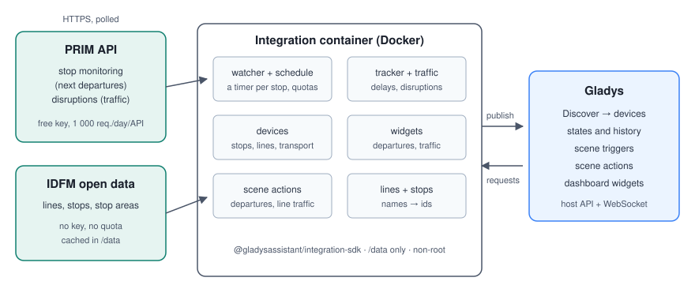
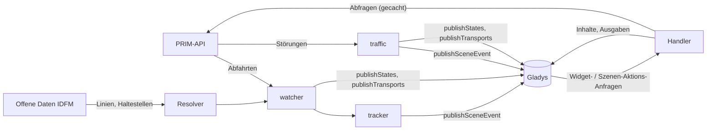
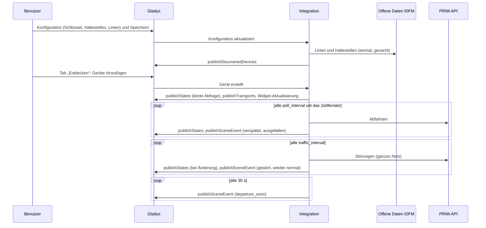
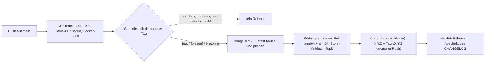

# Gladys Île-de-France Mobilités

[English](README.md) · [Français](README.fr.md) · **Deutsch** · [Español](README.es.md)

[](LICENSE)
[](https://github.com/William-De71/gladys-idfm/releases)
[](https://github.com/William-De71/gladys-idfm/actions/workflows/release.yml)
[](https://gladysassistant.com)

Externe Integration für [Gladys Assistant](https://gladysassistant.com) für den **öffentlichen Nahverkehr im
Großraum Paris**: die nächsten Abfahrten deiner Haltestellen in Echtzeit — RER, Transilien, Metro, Tram, Bus — mit
Verspätungen und Ausfällen, und der **Verkehr** deiner Linien (Störungen, Bauarbeiten), als Geräte,
**Szenen-Auslöser**, **Szenen-Aktionen** und **Dashboard-Widgets**, gebaut auf `@gladysassistant/integration-sdk`
0.15.

Daten: [PRIM](https://prim.iledefrance-mobilites.fr), die Open-Data-Plattform von Île-de-France Mobilités
(kostenloser Schlüssel, 1 000 Anfragen pro Tag und API bei einem neuen Konto), und die offenen Referenzdaten von
[data.iledefrance-mobilites.fr](https://data.iledefrance-mobilites.fr) (ohne Schlüssel), um Linien und
Haltestellen zu finden.

Benutzerdokumentation: [English](docs/en.md) · [Français](docs/fr.md) · [Deutsch](docs/de.md) ·
[Español](docs/es.md).

> Community-Integration, nicht verbunden mit oder unterstützt von Île-de-France Mobilités, SNCF oder RATP.

## Inhalt

- [Funktionen](#funktionen)
- [Architektur](#architektur)
- [Installation](#installation)
- [Konfiguration](#konfiguration)
- [Funktionsweise](#funktionsweise)
- [Entwicklung](#entwicklung)
- [Release und Commit-Konvention](#release-und-commit-konvention)
- [Fehlerbehebung](#fehlerbehebung)
- [Mitwirken](#mitwirken)
- [Lizenz](#lizenz)

## Funktionen

### Geräte

Ein Gerät pro eingerichteter **Haltestelle** (bis zu 3), alle Funktionen schreibgeschützt:

| Funktion           | Kategorie / Typ              | Hinweise                                                                  |
| ------------------ | ---------------------------- | ------------------------------------------------------------------------- |
| Nächste Abfahrt    | `text` / `text`              | „07:42 · RER B KASE → Aéroport CDG 2 · +5 min“, „… · fällt aus“           |
| Abfahrt in         | `duration` / `integer` (min) | Echtzeit-Wartezeit bis zur nächsten verkehrenden Abfahrt                  |
| Verspätung         | `duration` / `integer` (min) | erwartete − planmäßige Abfahrt (Züge mit Fahrplan; bei der Metro immer 0) |
| Gestörte Abfahrten | `counter-sensor` / `integer` | verfolgte Abfahrten mit Verspätung (ab der Schwelle) oder Ausfall         |

Ein Gerät pro verfolgter **Linie** (bis zu 6):

| Funktion           | Kategorie / Typ              | Hinweise                                                    |
| ------------------ | ---------------------------- | ----------------------------------------------------------- |
| Verkehr            | `text` / `text`              | „Normaler Verkehr“, „Gestört: <Titel>“, „Unterbrochen: …“   |
| Aktuelle Störungen | `counter-sensor` / `integer` | jetzt geltende Störungen, Informationsmeldungen ausgenommen |

Externe IDs: `ext:<selector>:stop:sp<Haltestellenbereich>[_<Linie>][_<Richtung>]` und
`ext:<selector>:line:<Linien-ID>` — einen Namen anders einzutippen behält das Gerät.

### Szenen-Auslöser

| Auslöser              | Löst aus, wenn …                                                                     | Filter                            |
| --------------------- | ------------------------------------------------------------------------------------ | --------------------------------- |
| `departure_delayed`   | ein Zug mit Fahrplan sich verspätet (Schwelle), dann erneut bei 15 und 30 min        | Haltestelle, Stufe (Mehrfachwahl) |
| `departure_cancelled` | eine verfolgte Abfahrt ausfällt                                                      | Haltestelle                       |
| `departure_soon`      | eine verfolgte Abfahrt in 2/5/10/15/20/30 min erfolgt, gerechnet ab der **Echtzeit** | Haltestelle, Minuten              |
| `line_disrupted`      | eine neue unterbrechende oder störende Störung eine verfolgte Linie betrifft         | Linie, Schwere, Ursache           |
| `line_restored`       | eine verfolgte Linie, die nicht normal war, bei zwei Abfragen in Folge normal ist    | Linie                             |

Jedes Ereignis liefert einen fertigen Satz `summary`. Abfahrtsereignisse lösen nur einmal pro Abfahrt aus (einen
Tag lang in `/data` gespeichert); Erinnerungen werden über Linie, Ziel und Uhrzeit (± 2 min) zugeordnet, da die
IDs der Metro von einer Abfrage zur nächsten wechseln. Eine Störung löst nur einmal aus (zwei Tage gespeichert);
die erste Abfrage einer Linie ist ein Ausgangszustand, keine Neuigkeit.

### Szenen-Aktionen

- `get_next_departures` (Haltestelle, leer = die erste): Linie, Ziel, Mission, planmäßige / erwartete Abfahrt,
  Minuten bis zur Abfahrt, Verspätung, Status (`on_time` / `delayed` / `cancelled`), Gleis, Anzahl gestörter
  Abfahrten, `summary`.
- `get_line_traffic` (Linie, leer = die erste): Zustand (`normal` / `disrupted` / `blocked`), Anzahl der
  Störungen, wichtigster Titel und Meldung, `summary`.

### Dashboard-Widgets

| Widget       | Inhalt                                                                                                                                                     |
| ------------ | ---------------------------------------------------------------------------------------------------------------------------------------------------------- |
| `departures` | Kachel „Abfahrt in“, dann die nächsten Abfahrten mit einem Badge in N min / +N min / fällt aus / am Bahnsteig; eine verfolgte oder eingegebene Haltestelle |
| `traffic`    | eine Statuszeile pro Linie (normal, gestört, unterbrochen), dann die aktuellen und kommenden 24-h-Störungen; ein Tippen öffnet die Meldung                 |

### Transport-Badge

Auf dem Geräte-Bildschirm zeigt jedes Haltestellen- und Linien-Gerät, wie es erreicht wird (`publishTransports`):
**cloud**, solange seine letzte Abfrage geklappt hat (die Abfahrten der Haltestelle, der Verkehr bei einer Linie),
**unerreichbar**, wenn sie fehlschlug (API ausgefallen, Schlüssel abgelehnt), und **cloud, eingeschränkt** mit dem
Grund, solange die Abfragen wegen des Tageskontingents oder der vorherigen Drosselung der Integration pausieren.
Wird nur bei einer Änderung gesendet.

### Sprachen

Englisch, Französisch, Deutsch und Spanisch: Manifest, Laufzeitmeldungen, Widgets, Szenen-Zusammenfassungen und
Benutzerdokumentation. Gladys übergibt die Sprache nur an die Widgets; Gerätenamen und Szenentexte folgen der
Einstellung **Sprache der Texte** (`auto` = die Sprache der letzten Widget-Anfrage). Haltestellen- und
Liniennamen sowie die Störungsmeldungen stammen von Île-de-France Mobilités, auf Französisch.

## Architektur





Vom Tab „Entdecken“ bis zu einem Zustand und einer Szene:



Die Integration ist reine Cloud (`transports: ["cloud"]`): Sie spricht mit den Web-APIs von PRIM und den offenen
Daten und mit nichts im lokalen Netz.

## Installation

In Gladys: **Integrationen → Store → Île-de-France Mobilités → Installieren**. Folge dann der
[Benutzerdokumentation](docs/de.md): PRIM-API-Schlüssel, Haltestellen, Linien, **Verbindung testen**, Tab
„Entdecken“.

Docker-Image: `ghcr.io/william-de71/gladys-idfm`, Multi-Arch (amd64/arm64), kein Root, schreibgeschütztes
Dateisystem, schreibt nur in `/data`, OCI-Labels und das Manifest im Label `io.gladysassistant.manifest`.

## Konfiguration

| Schlüssel            | Typ            | Hinweise                                                                                                       |
| -------------------- | -------------- | -------------------------------------------------------------------------------------------------------------- |
| `api_key`            | `secret`       | Pflicht, das PRIM-Token                                                                                        |
| `stop_<n>`           | `string`       | n = 1–3: ein Haltestellenname, eine Haltestellenbereichs-ID (`58774`, `STIF:StopArea:SP:58774:`) oder Steig-ID |
| `stop_<n>_line`      | `string`       | optional: `RER B`, `Transilien P`, `Métro 13`, `T3a`, `Bus 91`, `C01743`                                       |
| `stop_<n>_direction` | `string`       | optionale Wörter des Ziels, Alternativen mit `\|`                                                              |
| `stop_<n>_hours`     | `string`       | optionales Zeitfenster, `07:00-09:30`                                                                          |
| `stop_<n>_days`      | `multi_select` | optionale Reisetage (leer = jeden Tag)                                                                         |
| `lines`              | `string`       | die Linien, deren Verkehr verfolgt wird, durch Kommas getrennt (höchstens 6)                                   |
| `departure_count`    | `number`       | verfolgte Abfahrten pro Haltestelle, 1–8, Standard 4                                                           |
| `delay_threshold`    | `number`       | Minuten, ab denen ein Zug verspätet ist, 1–30, Standard 3                                                      |
| `poll_interval`      | `number`       | Minuten zwischen zwei Abfragen einer Haltestelle, 1–30, Standard 2                                             |
| `traffic_interval`   | `number`       | Minuten zwischen zwei Abfragen des Verkehrs, 2–60, Standard 5                                                  |
| `departures_quota`   | `number`       | das Tageskontingent der Abfahrts-API des Kontos, Standard 1 000                                                |
| `language`           | `select`       | Sprache der Gerätenamen und Szenentexte: `auto` (Standard), `en`, `fr`, `de`, `es`                             |

Interner Schlüssel (außerhalb des Schemas): `last_language`. Aktionen des Manifests: `test_connection`,
`search_stop` und `search_line` (beide auf den offenen Daten: kein Schlüssel, kein Kontingent).

## Funktionsweise

**Linien und Haltestellen.** Auf dem Open-Data-Portal aufgelöst (Opendatasoft, ohne Schlüssel) und in `/data`
gespeichert. Eine Linie: `referentiel-des-lignes` nach Kurzname — ohne Verkehrsmittel ist ein Buchstabe eine
Zuglinie und eine Zahl eine Metrolinie vor einer Buslinie; Ersatzbusse werden übersprungen. Eine Haltestelle mit
Linie: `arrets-lignes` dieser Linie, der nächstliegende Name; der Steig einer Metro-, Tram- oder Buslinie wird zu
seinem Haltestellenbereich (`arrets.zdaid`), damit beide Richtungen kommen. Eine Haltestelle ohne Linie:
`zones-d-arrets`, zuerst der exakte Name, Bahnhöfe vor Metro, Tram und Bus. Benutzertext gelangt nur als
bereinigtes String-Literal in ODSQL.

**Abfahrten.** `GET /marketplace/stop-monitoring?MonitoringRef=STIF:StopArea:SP:<id>:` (SIRI Lite, Header
`apikey`) — eine Anfrage pro Abfrage, alle Linien und Richtungen der Haltestelle; Linie und Richtung werden hier
gefiltert (kein `LineRef`: ein unbekanntes Paar ist ein Fehler). Seit März 2025 werden die SNCF-Züge nur noch pro
Haltestellenbereich geliefert. Werte sind verpackt (`{ value }`), Zeiten ISO UTC. Verspätung =
`ExpectedDepartureTime − AimedDepartureTime` (Metro und die meisten Busse haben keine planmäßige Zeit: keine
Verspätung); ausgefallen = `DepartureStatus` `cancelled`, `missed` oder `notExpected`; Mission = `JourneyNote`,
wenn es vier Großbuchstaben sind; Züge, die an der Haltestelle enden (ohne Abfahrtszeit), werden verworfen.

**Verkehr.** `GET /marketplace/disruptions_bulk/disruptions/v2`: alle Störungen des Netzes in einer Anfrage, mit
den Linien verknüpft über `lines[].impactedObjects[].disruptionIds`. Schwere `BLOQUANTE` → unterbrochen,
`PERTURBEE` → gestört, `INFORMATION` für den Zustand ignoriert; Zeiträume in Pariser Ortszeit
(`YYYYMMDDTHHMMSS`, über `Intl`); Duplikate (eine Meldung pro Haltestelle) nach Schwere und Titel
zusammengeführt.

**Zeitplan und Kontingent.** Die Abfahrts-API blickt nur etwa 2 Stunden voraus: Eine Haltestelle mit Zeitfenster
wird alle `poll_interval` Minuten ab einer Stunde davor bis zu seinem Ende gelesen, sonst **gar nicht**; ohne
Zeitfenster den ganzen Tag, nachts (01:30–05:00) alle 30 Minuten. Jede API hat einen eigenen Zähler über
gleitende 24 Stunden (`/data/quota-*.json`): Die regelmäßigen Abfragen stoppen bei 90 % des Limits; bräuchten
die eingerichteten Haltestellen mehr als 85 % davon, wird das Intervall automatisch verlängert. Ein `429` sperrt
die API bis zu ihrem `Retry-After` (standardmäßig eine Stunde). Widgets und Szenen-Aktionen verwenden eine
Abfrage, die jünger als 2 Minuten ist, erneut.

**Fehler.** `401` → „Schlüssel abgelehnt“ im Verbindungsstatus; SIRI-`ErrorCondition` → Fehler, ohne neuen
Versuch; 5xx- und Netzwerkfehler werden einmal wiederholt, danach werden die Abfragen bis zu 30 Minuten
gestreckt.

## Entwicklung

```bash
npm install
npm run format:check
npm run lint
npm test
npx github:GladysAssistant/integration-store . --skip-image-check
docker build -t gladys-idfm .
```

Node 22 oder neuer. Die Tests (`node --test`) greifen nie auf das Netz zu: Sie verwenden Antworten in der Form
der echten (geprüft an echten Stop-Monitoring-Antworten von 2025–2026 und der PRIM-Dokumentation) und prüfen
jeden Widget-Inhalt mit `validateWidgetContent` des SDK. Über die Unit-Tests hinaus:

- `test/structure.test.js` vergleicht die externen IDs, die Funktionsfelder, die der Tab „Entdecken“ vergleicht,
  und jeden Schlüssel des Manifests mit `test/fixtures/discovery.baseline.json` (Version 1.0.0): Bestehende
  Benutzer müssen nie ein Gerät neu anlegen;
- `test/i18n.test.js` prüft die vier Sprachen (Manifest, Laufzeittexte, Docs, READMEs) und validiert die
  Widget-Inhalte in jeder;
- `test/release.test.js` deckt das Release-Skript ab (Version, Changelog, Versionssprung).

`gladys_version` ist `>=5.1.1` (Widgets, Szenen-Auslöser und -Aktionen, `source: "devices"`).

Nur für die Entwicklung: `IDFM_PRIM_URL` und `IDFM_OPENDATA_URL` leiten die Clients auf andere Server um, und
`IDFM_DATA_DIR` verschiebt die Dateien von `/data`.

## Release und Commit-Konvention

Releases laufen automatisch. Jeder Push auf `main` startet den Release-Workflow:



- Commits und PR-Titel folgen den [Conventional Commits](https://www.conventionalcommits.org/), auf Englisch, für
  den Benutzer geschrieben: Sie werden zu den Zeilen des Changelogs. `feat` → minor, `fix` / `perf` → patch, `!`
  oder `BREAKING CHANGE:` → major.
- `CHANGELOG.md` wird beim Release erzeugt: nie von Hand bearbeiten.
- Das Image wird veröffentlicht und geprüft, **bevor** das Manifest auf `main` die neue Version ankündigt.
- Manueller Start (Actions → Release → Run workflow): `release-as` erzwingt eine Version, `dry-run` zeigt nur die
  Version und die Notizen.
- Ein geschütztes `main` würde den Release-Commit ablehnen: Erlaube GitHub Actions, die Regel zu umgehen, oder
  nutze das Token einer GitHub App.

## Fehlerbehebung

| Symptom                                         | Wahrscheinliche Ursache                                                                                              |
| ----------------------------------------------- | -------------------------------------------------------------------------------------------------------------------- |
| „Der PRIM-API-Schlüssel wird abgelehnt“         | Token falsch kopiert oder inzwischen neu erzeugt (ein neues Token macht das alte ungültig)                           |
| „Nicht gefunden: …“                             | der Name passt zu keiner Haltestelle oder Linie: **Haltestelle suchen** / **Linie suchen** verwenden                 |
| „Tageskontingent der PRIM-API erreicht“         | PRIM hat den Schlüssel bis zur angezeigten Zeit gesperrt: Zeitfenster, langsamere Aktualisierung, höheres Kontingent |
| Keine Verspätung bei der Metro                  | Metro und die meisten Busse haben keinen Fahrplan in den Echtzeitdaten: Nur die Wartezeit ist bekannt                |
| Gerätenamen oder Zusammenfassungen auf Englisch | **Sprache der Texte** einstellen oder einmal ein IDFM-Widget öffnen                                                  |

Ausführliche Logs: Setze die Umgebungsvariable `DEBUG=gladys-integration-sdk` am Container.

## Mitwirken

Issues und Pull Requests sind willkommen: Fehlerberichte mit der Gladys-Version, der Version der Integration und
den Logs ([Issue-Vorlagen](.github/ISSUE_TEMPLATE)). Rückmeldungen auch gern im
[Thread des Gladys-Forums](https://community.gladysassistant.com/t/integration-externe-ile-de-france-mobilites-rer-transilien-metro-tram-bus/11043).
Sicherheitsprobleme: siehe [SECURITY.md](SECURITY.md).

## Lizenz

[Apache-2.0](LICENSE) — siehe [NOTICE](NOTICE).

Daten: Île-de-France Mobilités — `referentiel-des-lignes` und `arrets-lignes` unter der
[ODbL](https://doc.transport.data.gouv.fr/le-point-d-acces-national/cadre-juridique/conditions-dutilisation-des-donnees/licence-odbl),
`zones-d-arrets` und `arrets` unter der [Licence Ouverte v2.0](https://www.etalab.gouv.fr/licence-ouverte-open-licence/),
die Echtzeit-APIs unter den Nutzungsbedingungen von PRIM. Die Integration liest sie nur, nichts wird
weiterverbreitet.
