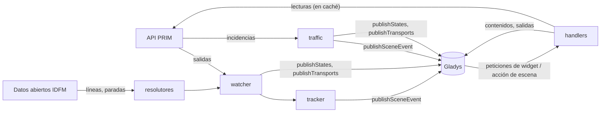
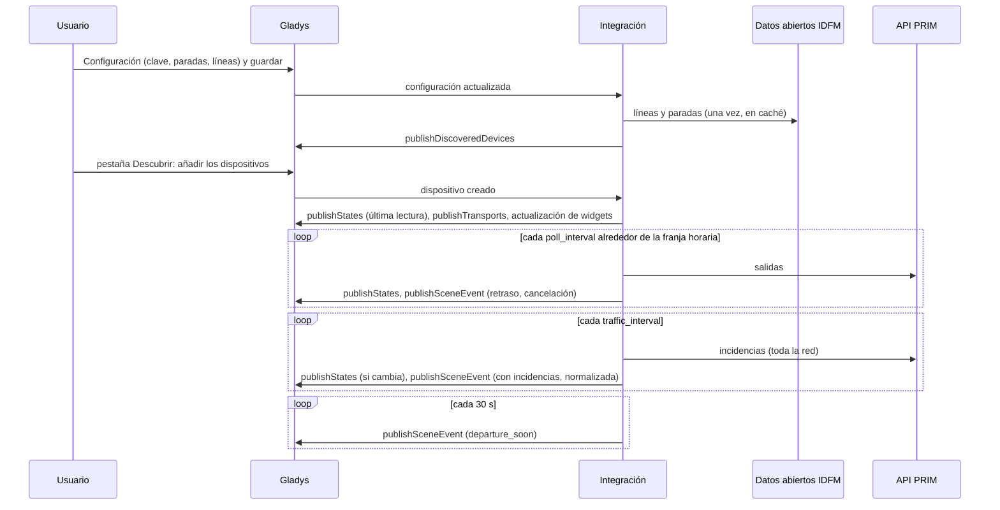
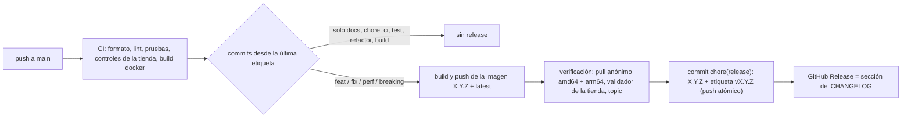

# Gladys Île-de-France Mobilités

[English](README.md) · [Français](README.fr.md) · [Deutsch](README.de.md) · **Español**

[](LICENSE)
[](https://github.com/William-De71/gladys-idfm/releases)
[](https://github.com/William-De71/gladys-idfm/actions/workflows/release.yml)
[](https://gladysassistant.com)

Integración externa de [Gladys Assistant](https://gladysassistant.com) para el **transporte público de la región
de París**: las próximas salidas de tus paradas en tiempo real — RER, Transilien, metro, tranvía, autobús — con
retrasos y cancelaciones, y el **tráfico** de tus líneas (incidencias, obras), como dispositivos, **disparadores de
escena**, **acciones de escena** y **widgets del panel**, construida sobre `@gladysassistant/integration-sdk` 0.15.

Datos: [PRIM](https://prim.iledefrance-mobilites.fr), la plataforma de datos abiertos de Île-de-France Mobilités
(clave gratuita, 1 000 peticiones al día por API en una cuenta nueva), y los datos de referencia abiertos de
[data.iledefrance-mobilites.fr](https://data.iledefrance-mobilites.fr) (sin clave) para encontrar líneas y
paradas.

Documentación de usuario: [English](docs/en.md) · [Français](docs/fr.md) · [Deutsch](docs/de.md) ·
[Español](docs/es.md).

> Integración comunitaria, sin relación con Île-de-France Mobilités, SNCF ni RATP, ni respaldada por ellos.

## Contenido

- [Funciones](#funciones)
- [Arquitectura](#arquitectura)
- [Instalación](#instalación)
- [Configuración](#configuración)
- [Funcionamiento](#funcionamiento)
- [Desarrollo](#desarrollo)
- [Release y convención de commits](#release-y-convención-de-commits)
- [Solución de problemas](#solución-de-problemas)
- [Contribuir](#contribuir)
- [Licencia](#licencia)

## Funciones

### Dispositivos

Un dispositivo por **parada** configurada (hasta 3), todas las funciones de solo lectura:

| Función                 | Categoría / tipo             | Notas                                                                      |
| ----------------------- | ---------------------------- | -------------------------------------------------------------------------- |
| Próxima salida          | `text` / `text`              | «07:42 · RER B KASE → Aéroport CDG 2 · +5 min», «… · cancelado»            |
| Sale en                 | `duration` / `integer` (min) | espera en tiempo real de la próxima salida que circula                     |
| Retraso                 | `duration` / `integer` (min) | salida estimada − salida prevista (trenes con horario; siempre 0 en metro) |
| Salidas con incidencias | `counter-sensor` / `integer` | salidas seguidas con retraso (desde el umbral) o canceladas                |

Un dispositivo por **línea** seguida (hasta 6):

| Función              | Categoría / tipo             | Notas                                                            |
| -------------------- | ---------------------------- | ---------------------------------------------------------------- |
| Tráfico              | `text` / `text`              | «Tráfico normal», «Con incidencias: <título>», «Interrumpido: …» |
| Incidencias en curso | `counter-sensor` / `integer` | incidencias vigentes, sin contar los mensajes informativos       |

Identificadores externos: `ext:<selector>:stop:sp<zona de parada>[_<línea>][_<dirección>]` y
`ext:<selector>:line:<id de línea>` — escribir un nombre de otra forma conserva el dispositivo.

### Disparadores de escena

| Disparador            | Se dispara cuando…                                                                                | Filtros                            |
| --------------------- | ------------------------------------------------------------------------------------------------- | ---------------------------------- |
| `departure_delayed`   | un tren con horario se retrasa (umbral), y de nuevo a los 15 y 30 min                             | parada, nivel (selección múltiple) |
| `departure_cancelled` | una salida seguida se cancela                                                                     | parada                             |
| `departure_soon`      | una salida seguida sale dentro de 2/5/10/15/20/30 min, contado sobre su salida **en tiempo real** | parada, minutos                    |
| `line_disrupted`      | una nueva incidencia que interrumpe o perturba afecta a una línea seguida                         | línea, gravedad, causa             |
| `line_restored`       | una línea seguida que no estaba normal lo está en dos lecturas seguidas                           | línea                              |

Cada evento incluye una frase `summary` lista para usar. Los eventos de salida solo se disparan una vez por salida
(guardada un día en `/data`); los recordatorios se emparejan por línea, destino y hora (± 2 min), ya que los
identificadores del metro cambian de una lectura a otra. Una incidencia solo se dispara una vez (guardada dos
días); la primera lectura de una línea es una referencia, no una novedad.

### Acciones de escena

- `get_next_departures` (parada, vacío = la primera): línea, destino, misión, salida prevista / estimada, minutos
  hasta la salida, retraso, estado (`on_time` / `delayed` / `cancelled`), vía, número de salidas con incidencias,
  `summary`.
- `get_line_traffic` (línea, vacío = la primera): estado (`normal` / `disrupted` / `blocked`), número de
  incidencias, título y mensaje principales, `summary`.

### Widgets del panel

| Widget       | Contenido                                                                                                                                             |
| ------------ | ----------------------------------------------------------------------------------------------------------------------------------------------------- |
| `departures` | ficha «sale en», luego las próximas salidas con una insignia en N min / +N min / cancelado / en andén; una parada seguida o escrita                   |
| `traffic`    | una fila de estado por línea (normal, con incidencias, interrumpida), luego las incidencias actuales y de las próximas 24 h; un toque abre el mensaje |

### Insignia de transporte

En la pantalla de dispositivos, cada dispositivo de parada o de línea muestra cómo se alcanza
(`publishTransports`): **cloud** mientras su última lectura funcionó (las salidas de la parada, el tráfico para una
línea), **inaccesible** cuando falló (API caída, clave rechazada), y **cloud, degradado** con el motivo mientras
las lecturas están en pausa por la cuota diaria o por la ralentización que la integración se impone antes. Solo se
envía cuando cambia.

### Idiomas

Inglés, francés, alemán y español: manifiesto, mensajes en ejecución, widgets, resúmenes de escena y documentación
de usuario. Gladys solo da el idioma a los widgets; los nombres de los dispositivos y los textos de escena siguen
el ajuste **Idioma de los textos** (`auto` = el idioma de la última petición de widget). Los nombres de paradas y
líneas y los mensajes de incidencias vienen de Île-de-France Mobilités, en francés.

## Arquitectura




De la pestaña Descubrir a un estado y una escena:



La integración es solo cloud (`transports: ["cloud"]`): se comunica con las API web de PRIM y de los datos
abiertos, y con nada de la red local.

## Instalación

Desde Gladys: **Integraciones → tienda → Île-de-France Mobilités → Instalar**. Después sigue la
[documentación de usuario](docs/es.md): clave de API de PRIM, paradas, líneas, **Probar la conexión**, pestaña
Descubrir.

Imagen Docker: `ghcr.io/william-de71/gladys-idfm`, multiarquitectura (amd64/arm64), sin root, sistema de archivos
de solo lectura, escribe solo en `/data`, etiquetas OCI y el manifiesto en la etiqueta
`io.gladysassistant.manifest`.

## Configuración

| Clave                | Tipo           | Notas                                                                                                  |
| -------------------- | -------------- | ------------------------------------------------------------------------------------------------------ |
| `api_key`            | `secret`       | obligatoria, el token de PRIM                                                                          |
| `stop_<n>`           | `string`       | n = 1–3: un nombre de parada, un id de zona de parada (`58774`, `STIF:StopArea:SP:58774:`) o de andén  |
| `stop_<n>_line`      | `string`       | opcional: `RER B`, `Transilien P`, `Métro 13`, `T3a`, `Bus 91`, `C01743`                               |
| `stop_<n>_direction` | `string`       | palabras opcionales del destino, alternativas con `\|`                                                 |
| `stop_<n>_hours`     | `string`       | franja opcional, `07:00-09:30`                                                                         |
| `stop_<n>_days`      | `multi_select` | días de viaje opcionales (vacío = todos los días)                                                      |
| `lines`              | `string`       | las líneas cuyo tráfico se sigue, separadas por comas (6 como máximo)                                  |
| `departure_count`    | `number`       | salidas seguidas por parada, 1–8, 4 por defecto                                                        |
| `delay_threshold`    | `number`       | minutos a partir de los cuales un tren va con retraso, 1–30, 3 por defecto                             |
| `poll_interval`      | `number`       | minutos entre dos lecturas de una parada, 1–30, 2 por defecto                                          |
| `traffic_interval`   | `number`       | minutos entre dos lecturas del tráfico, 2–60, 5 por defecto                                            |
| `departures_quota`   | `number`       | la cuota diaria de la API de salidas de la cuenta, 1 000 por defecto                                   |
| `language`           | `select`       | idioma de los nombres de dispositivos y textos de escena: `auto` (por defecto), `en`, `fr`, `de`, `es` |

Clave interna (fuera del esquema): `last_language`. Acciones del manifiesto: `test_connection`, `search_stop` y
`search_line` (estas dos sobre los datos abiertos: sin clave, sin cuota).

## Funcionamiento

**Líneas y paradas.** Se resuelven en el portal de datos abiertos (Opendatasoft, sin clave) y se guardan en
`/data`. Una línea: `referentiel-des-lignes` por nombre corto — sin modo, una letra es una línea de tren y un
número una línea de metro antes que de autobús; los autobuses de sustitución se descartan. Una parada con línea:
`arrets-lignes` de esa línea, el nombre más cercano; el andén de una línea de metro, tranvía o autobús se convierte
en su zona de parada (`arrets.zdaid`) para obtener ambos sentidos. Una parada sin línea: `zones-d-arrets`, primero
el nombre exacto, las estaciones de tren antes que metro, tranvía y autobús. El texto del usuario solo entra en
ODSQL como cadena literal saneada.

**Salidas.** `GET /marketplace/stop-monitoring?MonitoringRef=STIF:StopArea:SP:<id>:` (SIRI Lite, cabecera
`apikey`) — una petición por lectura, todas las líneas y direcciones de la parada; la línea y la dirección se
filtran aquí (sin `LineRef`: un par desconocido es un error). Desde marzo de 2025 los trenes de la SNCF solo se
dan por zona de parada. Los valores van envueltos (`{ value }`), las horas en ISO UTC. Retraso =
`ExpectedDepartureTime − AimedDepartureTime` (el metro y la mayoría de autobuses no tienen hora prevista: sin
retraso); cancelado = `DepartureStatus` `cancelled`, `missed` o `notExpected`; misión = `JourneyNote` cuando son
cuatro mayúsculas; los trenes que terminan en la parada (sin hora de salida) se descartan.

**Tráfico.** `GET /marketplace/disruptions_bulk/disruptions/v2`: todas las incidencias de la red en una petición,
enlazadas a las líneas mediante `lines[].impactedObjects[].disruptionIds`. Gravedad `BLOQUANTE` → interrumpida,
`PERTURBEE` → con incidencias, `INFORMATION` ignorada para el estado; periodos en hora local de París
(`YYYYMMDDTHHMMSS`, mediante `Intl`); duplicados (un mensaje por parada) fusionados por gravedad y título.

**Calendario y cuota.** La API de salidas solo mira unas 2 horas por delante: una parada con franja se lee cada
`poll_interval` minutos desde una hora antes hasta su final, y **nada** el resto del tiempo; sin franja, todo el
día, cada 30 minutos por la noche (01:30–05:00). Cada API tiene su propio contador sobre 24 horas móviles
(`/data/quota-*.json`): las lecturas regulares se detienen al 90 % del límite; cuando las paradas configuradas
necesitarían más del 85 %, el intervalo se alarga automáticamente. Un `429` bloquea la API hasta su `Retry-After`
(una hora por defecto). Los widgets y las acciones de escena reutilizan una lectura de menos de 2 minutos.

**Errores.** `401` → «clave rechazada» en el estado de conexión; `ErrorCondition` de SIRI → error, sin reintento;
los errores 5xx y de red se reintentan una vez y después las lecturas se espacian hasta 30 minutos.

## Desarrollo

```bash
npm install
npm run format:check
npm run lint
npm test
npx github:GladysAssistant/integration-store . --skip-image-check
docker build -t gladys-idfm .
```

Node 22 o posterior. Las pruebas (`node --test`) nunca acceden a la red: usan respuestas con la forma de las reales
(comprobadas con respuestas stop-monitoring reales de 2025–2026 y la documentación de PRIM) y validan cada
contenido de widget con `validateWidgetContent` del SDK. Además de las pruebas unitarias:

- `test/structure.test.js` compara los identificadores externos, los campos de función que compara la pestaña
  Descubrir y todas las claves del manifiesto con `test/fixtures/discovery.baseline.json` (versión 1.0.0): los
  usuarios existentes nunca tienen que volver a crear un dispositivo;
- `test/i18n.test.js` comprueba los cuatro idiomas (manifiesto, textos en ejecución, docs, README) y valida los
  contenidos de widget en cada uno;
- `test/release.test.js` cubre el script de release (versión, changelog, subida de versión).

`gladys_version` es `>=5.1.1` (widgets, disparadores y acciones de escena, `source: "devices"`).

Solo para desarrollo, `IDFM_PRIM_URL` e `IDFM_OPENDATA_URL` dirigen los clientes a otros servidores e
`IDFM_DATA_DIR` mueve los archivos de `/data`.

## Release y convención de commits

Las releases son automáticas. Cada push a `main` lanza el workflow Release:



- Los commits y títulos de PR siguen los [Conventional Commits](https://www.conventionalcommits.org/), en inglés,
  escritos para el usuario: se convierten en las líneas del changelog. `feat` → minor, `fix` / `perf` → patch,
  `!` o `BREAKING CHANGE:` → major.
- `CHANGELOG.md` se genera en la release: nunca lo edites a mano.
- La imagen se publica y se comprueba **antes** de que el manifiesto en `main` anuncie la nueva versión.
- Ejecución manual (Actions → Release → Run workflow): `release-as` fuerza una versión, `dry-run` solo muestra la
  versión y las notas.
- Una rama `main` protegida rechazaría el commit de release: permite que GitHub Actions omita la regla, o usa el
  token de una GitHub App.

## Solución de problemas

| Síntoma                                       | Causa probable                                                                                             |
| --------------------------------------------- | ---------------------------------------------------------------------------------------------------------- |
| «La clave de API de PRIM es rechazada»        | token mal copiado, o regenerado después (un token nuevo invalida el anterior)                              |
| «No encontrado: …»                            | el nombre no corresponde a ninguna parada ni línea: usa **Buscar una parada** / **Buscar una línea**       |
| «Cuota diaria de la API de PRIM alcanzada»    | PRIM bloqueó la clave hasta la hora indicada: franjas horarias, actualización más lenta, más cuota         |
| Sin retraso para el metro                     | el metro y la mayoría de autobuses no tienen horario en los datos en tiempo real: solo se conoce la espera |
| Nombres de dispositivos o resúmenes en inglés | ajusta **Idioma de los textos**, o abre una vez un widget de IDFM                                          |

Registros detallados: define la variable de entorno `DEBUG=gladys-integration-sdk` en el contenedor.

## Contribuir

Las issues y pull requests son bienvenidas: informes de errores con la versión de Gladys, la de la integración y
los registros ([plantillas de issue](.github/ISSUE_TEMPLATE)). También se agradecen los comentarios en el
[hilo del foro de Gladys](https://community.gladysassistant.com/t/integration-externe-ile-de-france-mobilites-rer-transilien-metro-tram-bus/11043).
Problemas de seguridad: consulta [SECURITY.md](SECURITY.md).

## Licencia

[Apache-2.0](LICENSE) — consulta [NOTICE](NOTICE).

Datos: Île-de-France Mobilités — `referentiel-des-lignes` y `arrets-lignes` bajo la
[ODbL](https://doc.transport.data.gouv.fr/le-point-d-acces-national/cadre-juridique/conditions-dutilisation-des-donnees/licence-odbl),
`zones-d-arrets` y `arrets` bajo la [Licence Ouverte v2.0](https://www.etalab.gouv.fr/licence-ouverte-open-licence/),
las API en tiempo real bajo las condiciones de uso de PRIM. La integración solo las lee, no se redistribuye nada.
