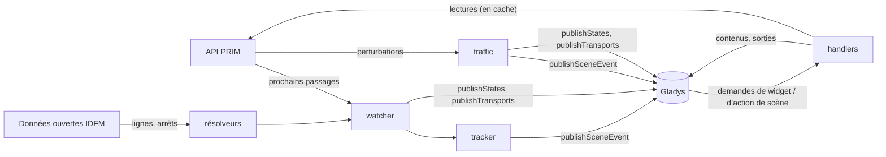
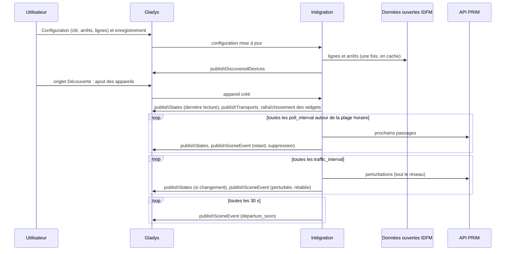
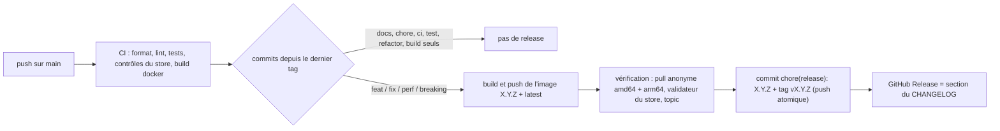

# Gladys Île-de-France Mobilités

[English](README.md) · **Français** · [Deutsch](README.de.md) · [Español](README.es.md)

[](LICENSE)
[](https://github.com/William-De71/gladys-idfm/releases)
[](https://github.com/William-De71/gladys-idfm/actions/workflows/release.yml)
[](https://gladysassistant.com)

Intégration externe de [Gladys Assistant](https://gladysassistant.com) pour les **transports en commun
franciliens** : les prochains départs de vos arrêts en temps réel — RER, Transilien, métro, tram, bus — avec
retards et suppressions, et le **trafic** de vos lignes (incidents, travaux), sous forme d’appareils, de
**déclencheurs de scène**, d’**actions de scène** et de **widgets de tableau de bord**, construite sur
`@gladysassistant/integration-sdk` 0.15.

Données : [PRIM](https://prim.iledefrance-mobilites.fr), la plateforme de données ouvertes d’Île-de-France
Mobilités (clé gratuite, 1 000 requêtes par jour et par API sur un nouveau compte), et les référentiels ouverts de
[data.iledefrance-mobilites.fr](https://data.iledefrance-mobilites.fr) (sans clé) pour trouver lignes et arrêts.

Documentation utilisateur : [English](docs/en.md) · [Français](docs/fr.md) · [Deutsch](docs/de.md) ·
[Español](docs/es.md).

> Intégration communautaire, sans lien avec Île-de-France Mobilités, la SNCF ou la RATP, ni approuvée par eux.

## Sommaire

- [Fonctionnalités](#fonctionnalités)
- [Architecture](#architecture)
- [Installation](#installation)
- [Configuration](#configuration)
- [Fonctionnement](#fonctionnement)
- [Développement](#développement)
- [Release et convention de commits](#release-et-convention-de-commits)
- [Dépannage](#dépannage)
- [Contribuer](#contribuer)
- [Licence](#licence)

## Fonctionnalités

### Appareils

Un appareil par **arrêt** configuré (jusqu’à 3), toutes les fonctionnalités en lecture seule :

| Fonctionnalité    | Catégorie / type             | Remarques                                                                |
| ----------------- | ---------------------------- | ------------------------------------------------------------------------ |
| Prochain départ   | `text` / `text`              | « 07:42 · RER B KASE → Aéroport CDG 2 · +5 min », « … · supprimé »       |
| Départ dans       | `duration` / `integer` (min) | attente en temps réel du prochain départ qui circule                     |
| Retard            | `duration` / `integer` (min) | départ estimé − départ prévu (trains avec horaire ; toujours 0 au métro) |
| Départs perturbés | `counter-sensor` / `integer` | départs suivis en retard (à partir du seuil) ou supprimés                |

Un appareil par **ligne** suivie (jusqu’à 6) :

| Fonctionnalité         | Catégorie / type             | Remarques                                                     |
| ---------------------- | ---------------------------- | ------------------------------------------------------------- |
| Trafic                 | `text` / `text`              | « Trafic normal », « Perturbé : <titre> », « Interrompu : … » |
| Perturbations en cours | `counter-sensor` / `integer` | perturbations en vigueur, messages d’information exclus       |

Identifiants externes : `ext:<selector>:stop:sp<zone d’arrêt>[_<ligne>][_<direction>]` et
`ext:<selector>:line:<id de ligne>` — retaper un nom autrement garde l’appareil.

### Déclencheurs de scène

| Déclencheur           | Se déclenche quand…                                                                    | Filtres                        |
| --------------------- | -------------------------------------------------------------------------------------- | ------------------------------ |
| `departure_delayed`   | un train avec horaire prend du retard (seuil), puis de nouveau à 15 et 30 min          | arrêt, niveau (choix multiple) |
| `departure_cancelled` | un départ suivi est supprimé                                                           | arrêt                          |
| `departure_soon`      | un départ suivi part dans 2/5/10/15/20/30 min, compté sur son départ **en temps réel** | arrêt, minutes                 |
| `line_disrupted`      | une nouvelle perturbation bloquante ou perturbante touche une ligne suivie             | ligne, gravité, cause          |
| `line_restored`       | une ligne suivie qui n’était pas normale l’est sur deux lectures de suite              | ligne                          |

Chaque événement fournit une phrase `summary` prête à l’emploi. Les événements de départ ne se déclenchent qu’une
fois par départ (mémorisé un jour dans `/data`) ; les rappels sont rapprochés par ligne, destination et horaire
(± 2 min), car les identifiants du métro changent d’une lecture à l’autre. Une perturbation ne se déclenche qu’une
fois (mémorisée deux jours) ; la première lecture d’une ligne sert de référence, pas de nouvelle.

### Actions de scène

- `get_next_departures` (arrêt, vide = le premier) : ligne, destination, mission, départ prévu / estimé, minutes
  avant le départ, retard, état (`on_time` / `delayed` / `cancelled`), voie, nombre de départs perturbés,
  `summary`.
- `get_line_traffic` (ligne, vide = la première) : état (`normal` / `disrupted` / `blocked`), nombre de
  perturbations, titre et message principaux, `summary`.

### Widgets de tableau de bord

| Widget       | Contenu                                                                                                                                    |
| ------------ | ------------------------------------------------------------------------------------------------------------------------------------------ |
| `departures` | tuile « départ dans », puis les prochains départs avec un badge dans N min / +N min / supprimé / à quai ; un arrêt suivi ou saisi          |
| `traffic`    | une ligne d’état par ligne (normal, perturbé, interrompu), puis les perturbations en cours et des 24 h à venir ; un appui ouvre le message |

### Badge de transport

Sur l’écran des appareils, chaque appareil arrêt ou ligne indique comment il est joint (`publishTransports`) :
**cloud** tant que sa dernière lecture a réussi (les départs de l’arrêt, le trafic pour une ligne),
**injoignable** quand elle a échoué (API en panne, clé refusée), et **cloud, dégradé** avec la raison quand les
lectures sont en pause à cause du quota quotidien ou du ralentissement que l’intégration s’impose avant lui.
Envoyé seulement quand il change.

### Langues

Anglais, français, allemand et espagnol : manifeste, messages à l’exécution, widgets, résumés de scène et
documentation utilisateur. Gladys ne donne la langue qu’aux widgets ; les noms d’appareils et les textes de scène
suivent le réglage **Langue des textes** (`auto` = la langue de la dernière demande de widget). Les noms d’arrêts,
de lignes et les messages de perturbation viennent d’Île-de-France Mobilités, en français.

## Architecture




De l’onglet Découverte à un état et une scène :



L’intégration est uniquement cloud (`transports: ["cloud"]`) : elle dialogue avec les API web de PRIM et des
données ouvertes, et avec rien sur le réseau local.

## Installation

Depuis Gladys : **Intégrations → store → Île-de-France Mobilités → Installer**. Suivez ensuite la
[documentation utilisateur](docs/fr.md) : clé d’API PRIM, arrêts, lignes, **Tester la connexion**, onglet
Découverte.

Image Docker : `ghcr.io/william-de71/gladys-idfm`, multi-architecture (amd64/arm64), utilisateur non root, système
de fichiers en lecture seule, écriture dans `/data` uniquement, labels OCI et manifeste dans le label
`io.gladysassistant.manifest`.

## Configuration

| Clé                  | Type           | Remarques                                                                                       |
| -------------------- | -------------- | ----------------------------------------------------------------------------------------------- |
| `api_key`            | `secret`       | obligatoire, le jeton PRIM                                                                      |
| `stop_<n>`           | `string`       | n = 1–3 : un nom d’arrêt, un id de zone d’arrêt (`58774`, `STIF:StopArea:SP:58774:`) ou de quai |
| `stop_<n>_line`      | `string`       | facultatif : `RER B`, `Transilien P`, `Métro 13`, `T3a`, `Bus 91`, `C01743`                     |
| `stop_<n>_direction` | `string`       | mots facultatifs de la destination, alternatives avec `\|`                                      |
| `stop_<n>_hours`     | `string`       | plage facultative, `07:00-09:30`                                                                |
| `stop_<n>_days`      | `multi_select` | jours de trajet facultatifs (vide = tous les jours)                                             |
| `lines`              | `string`       | les lignes dont le trafic est suivi, séparées par des virgules (6 au plus)                      |
| `departure_count`    | `number`       | départs suivis par arrêt, 1–8, 4 par défaut                                                     |
| `delay_threshold`    | `number`       | minutes à partir desquelles un train est en retard, 1–30, 3 par défaut                          |
| `poll_interval`      | `number`       | minutes entre deux lectures d’un arrêt, 1–30, 2 par défaut                                      |
| `traffic_interval`   | `number`       | minutes entre deux lectures du trafic, 2–60, 5 par défaut                                       |
| `departures_quota`   | `number`       | le quota quotidien de l’API des départs du compte, 1 000 par défaut                             |
| `language`           | `select`       | langue des noms d’appareils et des textes de scène : `auto` (défaut), `en`, `fr`, `de`, `es`    |

Clé interne (hors schéma) : `last_language`. Actions du manifeste : `test_connection`, `search_stop` et
`search_line` (ces deux-là sur les données ouvertes : sans clé, sans quota).

## Fonctionnement

**Lignes et arrêts.** Résolus sur le portail de données ouvertes (Opendatasoft, sans clé) et mémorisés dans
`/data`. Une ligne : `referentiel-des-lignes` par nom court — sans mode, une lettre est une ligne de train et un
nombre une ligne de métro avant une ligne de bus ; les bus de substitution sont écartés. Un arrêt avec une ligne :
`arrets-lignes` de cette ligne, le nom le plus proche ; le quai d’une ligne de métro, tram ou bus devient sa zone
d’arrêt (`arrets.zdaid`) pour avoir les deux sens. Un arrêt sans ligne : `zones-d-arrets`, le nom exact d’abord,
les gares avant le métro, le tram et le bus. Le texte saisi n’entre dans ODSQL que sous forme de chaîne littérale
nettoyée.

**Départs.** `GET /marketplace/stop-monitoring?MonitoringRef=STIF:StopArea:SP:<id>:` (SIRI Lite, en-tête
`apikey`) — une requête par lecture, toutes les lignes et directions de l’arrêt ; la ligne et la direction sont
filtrées ici (pas de `LineRef` : un couple inconnu est une erreur). Depuis mars 2025, les trains SNCF ne sont
donnés que par zone d’arrêt. Les valeurs sont enveloppées (`{ value }`), les heures en ISO UTC. Retard =
`ExpectedDepartureTime − AimedDepartureTime` (le métro et la plupart des bus n’ont pas d’heure prévue : pas de
retard) ; supprimé = `DepartureStatus` `cancelled`, `missed` ou `notExpected` ; mission = `JourneyNote` quand ce
sont quatre majuscules ; les trains terminus à l’arrêt (sans heure de départ) sont ignorés.

**Trafic.** `GET /marketplace/disruptions_bulk/disruptions/v2` : toutes les perturbations du réseau en une
requête, reliées aux lignes par `lines[].impactedObjects[].disruptionIds`. Gravité `BLOQUANTE` → interrompu,
`PERTURBEE` → perturbé, `INFORMATION` ignorée pour l’état ; périodes en heure de Paris (`YYYYMMDDTHHMMSS`, via
`Intl`) ; doublons (un message par arrêt) fusionnés par gravité et titre.

**Calendrier et quota.** L’API des départs ne voit qu’environ 2 heures à l’avance : un arrêt avec plage est lu
toutes les `poll_interval` minutes d’une heure avant la plage jusqu’à sa fin, et **pas du tout** le reste du
temps ; sans plage, toute la journée, toutes les 30 minutes la nuit (01:30–05:00). Chaque API a son propre
compteur sur 24 heures glissantes (`/data/quota-*.json`) : les lectures régulières s’arrêtent à 90 % de la
limite ; quand les arrêts configurés demanderaient plus de 85 %, l’intervalle est allongé automatiquement. Un
`429` bloque l’API jusqu’à son `Retry-After` (une heure par défaut). Widgets et actions de scène réutilisent une
lecture de moins de 2 minutes.

**Erreurs.** `401` → « clé refusée » dans l’état de connexion ; `ErrorCondition` SIRI → erreur, sans nouvel
essai ; les erreurs 5xx et réseau sont réessayées une fois, puis les lectures s’espacent jusqu’à 30 minutes.

## Développement

```bash
npm install
npm run format:check
npm run lint
npm test
npx github:GladysAssistant/integration-store . --skip-image-check
docker build -t gladys-idfm .
```

Node 22 ou plus récent. Les tests (`node --test`) n’accèdent jamais au réseau : ils utilisent des réponses
conformes aux vraies (vérifiées sur de vraies réponses stop-monitoring de 2025–2026 et la documentation PRIM) et
vérifient chaque contenu de widget avec `validateWidgetContent` du SDK. En plus des tests unitaires :

- `test/structure.test.js` compare les identifiants externes, les champs de fonctionnalité que compare l’onglet
  Découverte et toutes les clés du manifeste à `test/fixtures/discovery.baseline.json` (version 1.0.0) : les
  utilisateurs existants n’ont jamais à recréer un appareil ;
- `test/i18n.test.js` vérifie les quatre langues (manifeste, textes à l’exécution, docs, README) et valide les
  contenus de widget dans chacune ;
- `test/release.test.js` couvre le script de release (version, changelog, montée de version).

`gladys_version` vaut `>=5.1.1` (widgets, déclencheurs et actions de scène, `source: "devices"`).

Pour le développement uniquement, `IDFM_PRIM_URL` et `IDFM_OPENDATA_URL` dirigent les clients vers d’autres
serveurs et `IDFM_DATA_DIR` déplace les fichiers de `/data`.

## Release et convention de commits

Les releases sont automatiques. Chaque push sur `main` lance le workflow Release :



- Les commits et titres de PR suivent les [Conventional Commits](https://www.conventionalcommits.org/), en
  anglais, rédigés pour l’utilisateur : ils deviennent les lignes du changelog. `feat` → minor, `fix` / `perf` →
  patch, `!` ou `BREAKING CHANGE:` → major.
- `CHANGELOG.md` est généré à la release : ne jamais le modifier à la main.
- L’image est publiée et vérifiée **avant** que le manifeste sur `main` annonce la nouvelle version.
- Lancement manuel (Actions → Release → Run workflow) : `release-as` force une version, `dry-run` affiche seulement
  la version et les notes.
- Une branche `main` protégée refuserait le commit de release : autorisez GitHub Actions à contourner la règle, ou
  utilisez le jeton d’une GitHub App.

## Dépannage

| Symptôme                                  | Cause probable                                                                                              |
| ----------------------------------------- | ----------------------------------------------------------------------------------------------------------- |
| « La clé d’API PRIM est refusée »         | jeton mal copié, ou régénéré depuis (un nouveau jeton invalide l’ancien)                                    |
| « Introuvable : … »                       | le nom ne correspond à aucun arrêt ni ligne : utilisez **Chercher un arrêt** / **Chercher une ligne**       |
| « Quota quotidien de l’API PRIM atteint » | PRIM a bloqué la clé jusqu’à l’heure indiquée : plages horaires, rafraîchissement plus lent, quota relevé   |
| Pas de retard pour le métro               | le métro et la plupart des bus n’ont pas d’horaire dans les données temps réel : seule l’attente est connue |
| Noms d’appareils ou résumés en anglais    | réglez **Langue des textes**, ou affichez une fois un widget IDFM                                           |

Logs détaillés : définissez la variable d’environnement `DEBUG=gladys-integration-sdk` sur le conteneur.

## Contribuer

Les issues et pull requests sont les bienvenues : signalements de bug avec la version de Gladys, celle de
l’intégration et les logs ([modèles d’issue](.github/ISSUE_TEMPLATE)). Les retours sont aussi bienvenus sur le
[fil du forum Gladys](https://community.gladysassistant.com/t/integration-externe-ile-de-france-mobilites-rer-transilien-metro-tram-bus/11043).
Problèmes de sécurité : voir [SECURITY.md](SECURITY.md).

## Licence

[Apache-2.0](LICENSE) — voir [NOTICE](NOTICE).

Données : Île-de-France Mobilités — `referentiel-des-lignes` et `arrets-lignes` sous
[ODbL](https://doc.transport.data.gouv.fr/le-point-d-acces-national/cadre-juridique/conditions-dutilisation-des-donnees/licence-odbl),
`zones-d-arrets` et `arrets` sous [Licence Ouverte v2.0](https://www.etalab.gouv.fr/licence-ouverte-open-licence/),
les API temps réel sous les conditions d’utilisation de PRIM. L’intégration ne fait que les lire, rien n’est
redistribué.
