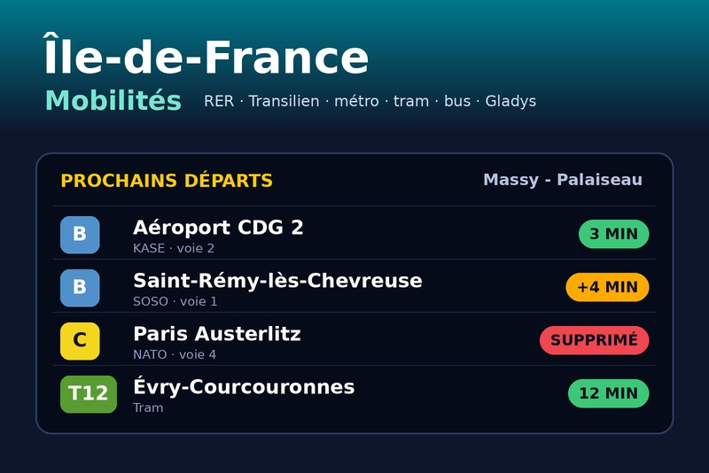
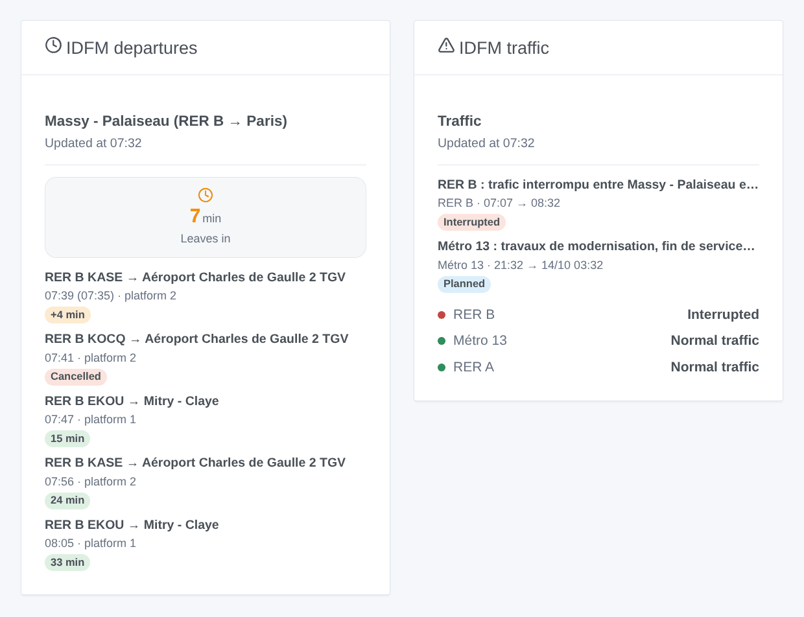
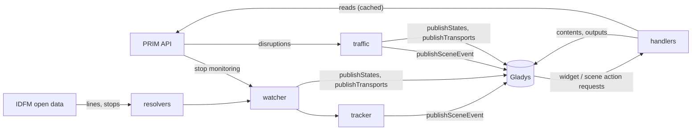
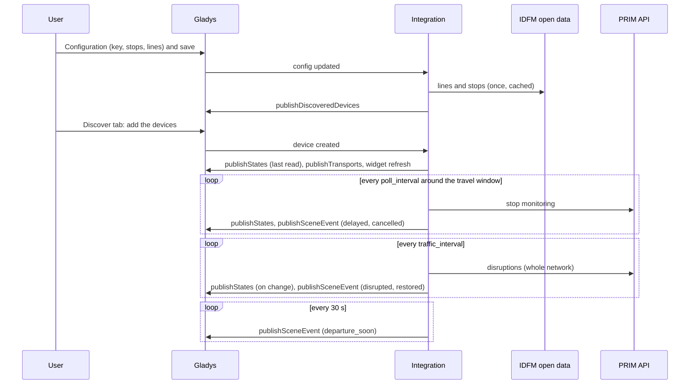
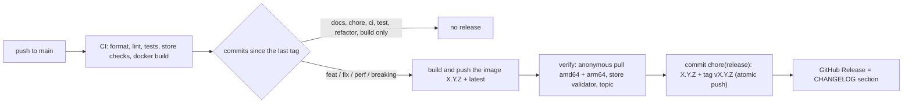

# Gladys Île-de-France Mobilités

**English** · [Français](README.fr.md) · [Deutsch](README.de.md) · [Español](README.es.md)

[](LICENSE)
[](https://github.com/William-De71/gladys-idfm/releases)
[](https://github.com/William-De71/gladys-idfm/actions/workflows/release.yml)
[](https://gladysassistant.com)



External [Gladys Assistant](https://gladysassistant.com) integration for the **public transport of the Paris region**:
the next departures of your stops in real time — RER, Transilien, metro, tram, bus — with delays and cancellations,
and the **traffic** of your lines (incidents, works), as devices, **scene triggers**, **scene actions** and
**dashboard widgets**, built on `@gladysassistant/integration-sdk` 0.16.

Data: [PRIM](https://prim.iledefrance-mobilites.fr), the open data platform of Île-de-France Mobilités (free key,
1 000 requests a day per API on a new account), and the open reference data of
[data.iledefrance-mobilites.fr](https://data.iledefrance-mobilites.fr) (no key) to find lines and stops.



User documentation: [English](docs/en.md) · [Français](docs/fr.md) · [Deutsch](docs/de.md) · [Español](docs/es.md).

> Community integration, not affiliated with or endorsed by Île-de-France Mobilités, SNCF or RATP.

## Contents

- [Features](#features)
- [Architecture](#architecture)
- [Installation](#installation)
- [Configuration](#configuration)
- [How it works](#how-it-works)
- [Development](#development)
- [Release and commit convention](#release-and-commit-convention)
- [Troubleshooting](#troubleshooting)
- [Contributing](#contributing)
- [License](#license)

## Features

### Devices

A device per configured **stop** (up to 3), all features read-only:

| Feature              | Category / type              | Notes                                                              |
| -------------------- | ---------------------------- | ------------------------------------------------------------------ |
| Next departure       | `text` / `text`              | "07:42 · RER B KASE → Aéroport CDG 2 · +5 min", "… · cancelled"    |
| Leaves in            | `duration` / `integer` (min) | real-time wait of the next departure that runs                     |
| Delay                | `duration` / `integer` (min) | expected − aimed departure (timetabled trains; always 0 for metro) |
| Disrupted departures | `counter-sensor` / `integer` | followed departures delayed (from the threshold) or cancelled      |

A device per followed **line** (up to 6):

| Feature             | Category / type              | Notes                                                    |
| ------------------- | ---------------------------- | -------------------------------------------------------- |
| Traffic             | `text` / `text`              | "Normal traffic", "Disrupted: <title>", "Interrupted: …" |
| Current disruptions | `counter-sensor` / `integer` | disruptions applying now, information messages left out  |

External ids: `ext:<selector>:stop:sp<stop area>[_<line>][_<direction>]` and `ext:<selector>:line:<line id>` —
retyping a name differently keeps the device.

### Scene triggers

| Trigger               | Fires when…                                                                        | Filters                    |
| --------------------- | ---------------------------------------------------------------------------------- | -------------------------- |
| `departure_delayed`   | a timetabled train becomes late (threshold), then again at 15 and 30 min           | stop, level (multi-select) |
| `departure_cancelled` | a followed departure is cancelled                                                  | stop                       |
| `departure_soon`      | a followed departure leaves in 2/5/10/15/20/30 min, on its **real-time** departure | stop, minutes              |
| `line_disrupted`      | a new blocking or disrupting disruption applies to a followed line                 | line, severity, cause      |
| `line_restored`       | a followed line that was not normal is normal on two reads in a row                | line                       |

Every event carries a ready-made `summary` sentence. Departure events fire once per departure (kept in `/data` for
a day); reminders are matched by line, destination and time (± 2 min), since metro ids are not stable from one read
to the next. A disruption fires once (kept two days); the first read of a line is a baseline, not news.

### Scene actions

- `get_next_departures` (stop, empty = the first): line, destination, mission, scheduled / expected departure,
  minutes until departure, delay, status (`on_time` / `delayed` / `cancelled`), platform, disrupted count, `summary`.
- `get_line_traffic` (line, empty = the first): state (`normal` / `disrupted` / `blocked`), disruption count, main
  title and message, `summary`.

### Dashboard widgets

| Widget       | Content                                                                                                                        |
| ------------ | ------------------------------------------------------------------------------------------------------------------------------ |
| `departures` | "leaves in" tile, then the next departures with an in N min / +N min / cancelled / at the stop badge; a followed or typed stop |
| `traffic`    | a status row per line (normal, disrupted, interrupted), then the current and next-24 h disruptions; a tap opens the message    |

### Transport badge

On the Devices screen, each stop and line device shows how it is reached (`publishTransports`): **cloud** while
its last read worked (the departures of the stop, the traffic for a line), **unreachable** when it failed (API
down, key refused), and **cloud, degraded** with the reason while the reads are paused by the daily quota or by the
integration slowing down before it. Sent only when it changes.

### Languages

English, French, German and Spanish: manifest, runtime messages, widgets, scene summaries and user docs. Gladys
gives the language to the widgets only; device names and scene texts use the **Language of the texts** setting
(`auto` = the language of the last widget request). Stop names, line names and the disruption messages come from
Île-de-France Mobilités, in French.

## Architecture




From the Discover tab to a state and a scene:



The integration is cloud-only (`transports: ["cloud"]`): it talks to the PRIM and open data web APIs and nothing
on the local network.

## Installation

From Gladys: **Integrations → store → Île-de-France Mobilités → Install**. Then follow the
[user documentation](docs/en.md): PRIM API key, stops, lines, **Test the connection**, Discover tab.

Docker image: `ghcr.io/william-de71/gladys-idfm`, multi-arch (amd64/arm64), non-root, read-only rootfs, writes in
`/data` only, OCI labels and the manifest as the `io.gladysassistant.manifest` label.

## Configuration

| Key                  | Type           | Notes                                                                                  |
| -------------------- | -------------- | -------------------------------------------------------------------------------------- |
| `api_key`            | `secret`       | required, the PRIM token                                                               |
| `stop_<n>`           | `string`       | n = 1–3: a stop name, a stop area id (`58774`, `STIF:StopArea:SP:58774:`) or a quay id |
| `stop_<n>_line`      | `string`       | optional: `RER B`, `Transilien P`, `Métro 13`, `T3a`, `Bus 91`, `C01743`               |
| `stop_<n>_direction` | `string`       | optional words of the destination, alternatives with `\|`                              |
| `stop_<n>_hours`     | `string`       | optional window, `07:00-09:30`                                                         |
| `stop_<n>_days`      | `multi_select` | optional travel days (empty = every day)                                               |
| `lines`              | `string`       | the lines whose traffic is followed, comma separated (6 max)                           |
| `departure_count`    | `number`       | departures followed per stop, 1–8, default 4                                           |
| `delay_threshold`    | `number`       | minutes from which a train is delayed, 1–30, default 3                                 |
| `poll_interval`      | `number`       | minutes between two reads of a stop, 1–30, default 2                                   |
| `traffic_interval`   | `number`       | minutes between two reads of the traffic, 2–60, default 5                              |
| `departures_quota`   | `number`       | the daily quota of the departures API of the account, default 1 000                    |
| `language`           | `select`       | language of the device names and scene texts: `auto` (default), `en`, `fr`, `de`, `es` |

Internal key (outside the schema): `last_language`. Manifest actions: `test_connection`, `search_stop` and
`search_line` (both on the open data: no key, no quota).

## How it works

**Lines and stops.** Resolved on the open data portal (Opendatasoft, no key) and remembered in `/data`. A line:
`referentiel-des-lignes` by short name — without a mode, a letter is a train line and a number a metro line before a
bus one; replacement buses are skipped. A stop with a line: `arrets-lignes` of that line, the closest name; the
quay of a metro, tram or bus line becomes its stop area (`arrets.zdaid`) so both directions come back. A stop
without a line: `zones-d-arrets`, the exact name first, train stations before metro, tram and bus. User text only
enters ODSQL as a sanitized string literal.

**Departures.** `GET /marketplace/stop-monitoring?MonitoringRef=STIF:StopArea:SP:<id>:` (SIRI Lite, `apikey`
header) — one request per read, every line and direction of the stop; the line and the direction are filtered
here (no `LineRef`: an unknown pair is an error). Since March 2025 the SNCF trains are only given per stop area.
Values are wrapped (`{ value }`), times ISO UTC. Delay = `ExpectedDepartureTime − AimedDepartureTime` (metro and
most buses have no aimed time: no delay); cancelled = `DepartureStatus` `cancelled`, `missed` or `notExpected`;
mission = `JourneyNote` when it is four capitals; trains ending at the stop (no departure time) are dropped.

**Traffic.** `GET /marketplace/disruptions_bulk/disruptions/v2`: every disruption of the network in one request,
linked to lines through `lines[].impactedObjects[].disruptionIds`. Severity `BLOQUANTE` → blocked, `PERTURBEE` →
disrupted, `INFORMATION` ignored for the state; periods in Paris local time (`YYYYMMDDTHHMMSS`, through `Intl`);
duplicates (one message per stop) merged by severity and title.

**Schedule and quota.** The departures API only looks about 2 hours ahead: a stop with a window is read every
`poll_interval` minutes from an hour before it to its end, and **not at all** otherwise; without a window, all day,
every 30 minutes at night (01:30–05:00). Each API has its own counter over a sliding 24 hours (`/data/quota-*.json`):
the regular reads stop at 90 % of the limit; when the configured stops would need more than 85 % of it, the poll
interval is stretched automatically. A `429` blocks the API until its `Retry-After` (an hour by default). Widgets
and scene actions reuse a read under 2 minutes old.

**Errors.** `401` → "key refused" in the connection status; SIRI `ErrorCondition` → an error, not retried; 5xx and
network failures are retried once, then the reads back off up to 30 minutes.

## Development

```bash
npm install
npm run format:check
npm run lint
npm test
npx github:GladysAssistant/integration-store . --skip-image-check
docker build -t gladys-idfm .
```

Node 22 or later. The tests (`node --test`) never touch the network: they use answers shaped like the real ones
(checked against real 2025–2026 stop-monitoring answers and the PRIM documentation) and check every widget content
with the SDK `validateWidgetContent`. Beyond the unit tests:

- `test/structure.test.js` compares the device external ids, the feature fields the Discover tab compares and
  every key of the manifest with `test/fixtures/discovery.baseline.json` (version 1.0.0): existing users never
  have to recreate a device;
- `test/i18n.test.js` checks the four languages (manifest, runtime texts, docs, READMEs) and validates the widget
  contents in each;
- `test/release.test.js` covers the release script (version, changelog, bump).
- `docs/illustrations/render.sh` regenerates the widget illustrations of `docs/assets` from the widget code
  (headless Chrome, the Gladys front styles): run it after any change to a widget.

`gladys_version` is `>=5.3.0` (catalog keywords and countries of Gladys 5.3, widgets, scene triggers and actions, `source: "devices"`).

For development only, `IDFM_PRIM_URL` and `IDFM_OPENDATA_URL` point the clients to other servers and
`IDFM_DATA_DIR` moves the files of `/data`.

## Release and commit convention

Releases are automatic. Every push to `main` runs the Release workflow:



- Commits and PR titles follow [Conventional Commits](https://www.conventionalcommits.org/), in English, written
  for the user: they become the changelog lines. `feat` → minor, `fix` / `perf` → patch, `!` or `BREAKING
CHANGE:` → major.
- `CHANGELOG.md` is generated at the release: never edit it by hand.
- The image is published and checked **before** the manifest on `main` announces the new version.
- Manual run (Actions → Release → Run workflow): `release-as` forces a version, `dry-run` only shows the version
  and the notes.
- A protected `main` would reject the release commit: allow GitHub Actions to bypass the rule, or use a GitHub
  App token.

## Troubleshooting

| Symptom                               | Likely cause                                                                                     |
| ------------------------------------- | ------------------------------------------------------------------------------------------------ |
| "The PRIM API key is refused"         | token miscopied, or regenerated since (a new token invalidates the old one)                      |
| "Not found: …"                        | the name matches no stop or line: use **Find a stop** / **Find a line** and paste the number     |
| "Daily quota of the PRIM API reached" | PRIM blocked the key until the time shown: add travel windows, slow the refresh, raise the quota |
| No delay for the metro                | the metro and most buses have no timetable in the real-time data: only the wait is known         |
| Device names or summaries in English  | set **Language of the texts**, or open an IDFM widget once                                       |

Detailed logs: set the environment variable `DEBUG=gladys-integration-sdk` on the container.

## Contributing

Issues and pull requests are welcome: bug reports with the Gladys version, the integration version and the logs
([issue templates](.github/ISSUE_TEMPLATE)). Feedback on the
[Gladys forum thread](https://community.gladysassistant.com/t/integration-externe-ile-de-france-mobilites-rer-transilien-metro-tram-bus/11043)
too. Security problems: see [SECURITY.md](SECURITY.md).

## License

[Apache-2.0](LICENSE) — see [NOTICE](NOTICE).

Data: Île-de-France Mobilités — `referentiel-des-lignes` and `arrets-lignes` under the
[ODbL](https://doc.transport.data.gouv.fr/le-point-d-acces-national/cadre-juridique/conditions-dutilisation-des-donnees/licence-odbl),
`zones-d-arrets` and `arrets` under the [Licence Ouverte v2.0](https://www.etalab.gouv.fr/licence-ouverte-open-licence/),
the real-time APIs under the PRIM terms of use. The integration only reads them, nothing is redistributed.
